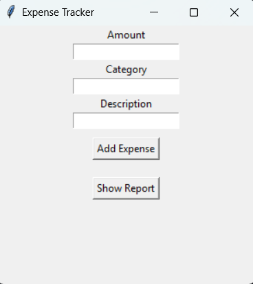

# 💰 SMART EXPENSE TRACKER
### Track Your Money. Understand Your Spending. Stay in Control.

<p align="center">
  A simple yet practical Python-based expense management application designed to make daily expense tracking easier, smarter, and more organized.
</p>

<p align="center">
  
  
  
  
  
</p>

---

## ✨ ABOUT THE PROJECT

Managing daily expenses is important, but keeping track of every transaction can become difficult.

**Smart Expense Tracker** is a Python-based desktop application developed to help users record, organize, and monitor their daily spending through a simple graphical interface.

Built as part of my Semester 2 engineering coursework, this project combines Python programming fundamentals with practical application development.

The idea was simple:

> **Know where your money goes, one expense at a time.**

---

## 🚀 FEATURES

<table>
<tr>
<td width="50%">

### ➕ Add Expenses
Easily record daily expenses and maintain a structured spending history.

</td>
<td width="50%">

### 💾 Data Storage
Save expense information using file handling for future access.

</td>
</tr>
<tr>
<td width="50%">

### 📊 Expense Summary
Calculate and view the total amount spent.

</td>
<td width="50%">

### 🖥️ Interactive GUI
A simple desktop interface built using Python Tkinter.

</td>
</tr>
<tr>
<td width="50%">

### 📈 Data Visualization
Use Matplotlib to visualize expense-related information.

</td>
<td width="50%">

### 🐍 Object-Oriented Design
Apply Python classes and objects to organize application logic.

</td>
</tr>
</table>

---

## 📸 APPLICATION PREVIEW

<p align="center">
  <strong>See Smart Expense Tracker in Action</strong>
</p>

<p align="center">
  <a href="https://github.com/abhishek-s-gupta/Smart-Expense-Tracker/blob/main/output.png">
    
  </a>
</p>

<p align="center">
  <sub>Application output and graphical interface.</sub>
</p>

---

## 🛠️ TECHNOLOGY STACK

<p align="center">
  
</p>

| Technology | Purpose |
|---|---|
| Python | Core application development |
| Tkinter | Graphical User Interface |
| Pandas | Data organization and processing |
| Matplotlib | Expense visualization |
| File Handling | Persistent expense storage |
| OOP | Structured application development |

---

## ⚙️ GETTING STARTED

Follow these steps to run the project locally.

### Prerequisites

- Python 3.x
- pip package manager

### 1. Clone the Repository

```bash
git clone https://github.com/abhishek-s-gupta/Smart-Expense-Tracker.git
```

### 2. Navigate to the Project Folder

```bash
cd Smart-Expense-Tracker
```

### 3. Install Dependencies

```bash
pip install pandas matplotlib
```

### 4. Run the Application

```bash
python main.py
```

That's it! Your Smart Expense Tracker is ready to use.

---

## 📂 PROJECT STRUCTURE

```text
Smart-Expense-Tracker/
│
├── main.py          # Main application
├── output.png       # Application screenshot
└── README.md        # Project documentation
```

---

## 🧠 WHAT I LEARNED

This project helped me move beyond theoretical programming and understand how Python concepts work together in a real application.

Key takeaways:

- Understanding Object-Oriented Programming.
- Implementing classes and objects.
- Reading and writing data using file handling.
- Building desktop applications with Tkinter.
- Organizing data with Pandas.
- Creating visualizations using Matplotlib.
- Connecting multiple Python concepts into one project.

---

## 🎯 PROJECT PURPOSE

**Learning by Building.**

This project was developed during my first year of engineering as part of my Semester 2 coursework.

Rather than just learning Python syntax, I wanted to build something practical that demonstrates how programming can solve everyday problems.

---

## 🔮 FUTURE IMPROVEMENTS

Some features I would like to explore in future versions:

- [ ] Monthly and weekly expense reports.
- [ ] Expense categories and filtering.
- [ ] Budget planning and spending limits.
- [ ] Export reports to CSV and PDF.
- [ ] Improved dashboard and visualizations.
- [ ] Database integration.
- [ ] Better UI and user experience.

---

<p align="center">
  
</p>

<h2 align="center">💰 SMART EXPENSE TRACKER</h2>

<p align="center">
  <strong>Small Project. Practical Learning. Real-World Thinking.</strong>
</p>

<p align="center">
  Built with 🐍 Python and ❤️ as a First-Year Engineering Project.
</p>

<p align="center">
  <sub>© 2026 Smart Expense Tracker</sub>
</p>
